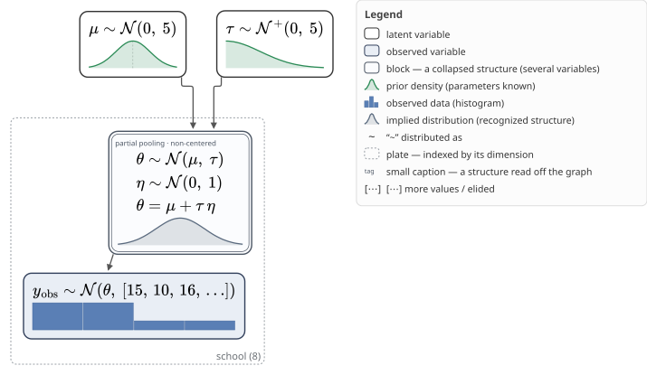

# bayesdag

**Shape-first, posterior-aware, interactive visualizations of PyMC models.**

`bayesdag` renders a PyMC model as a rich generative-model diagram where **every node whose shape is knowable shows it** — so you can read the data-generating story off the curves (Kruschke-style) — with real **LaTeX math inside nodes**, **edges that point at the specific parameter** they feed, and prior/posterior overlays. It has a **static SVG renderer** (publication-quality) and an **interactive [anywidget](https://anywidget.dev)** renderer (Jupyter + [marimo](https://marimo.io)); both consume the same layout pass and the same rendered math, so the diagram itself is identical, and it falls back to static automatically when interactivity isn't available.

It also reads **well-known compound structures** off the graph — hierarchies, shrinkage priors, regressions — and by default draws an **overview** in which each structure is one labelled box carrying its implied distribution, with the full variable graph a toggle away (see [Recognized structures](#recognized-structures)).

> **Status: pre-alpha.** M0 (the vertical slice) has landed, PyMC distribution coverage is complete, and the first slice of M2 is in: live posterior attachment, hedged convergence diagnostics on the nodes, and the funnel joint. The remaining M2 panels (parallel coordinates, energy) and the interop exporters are not built. See [`COVERAGE.md`](COVERAGE.md) for the live work-plan and [`docs/RESEARCH.md`](docs/RESEARCH.md) for background.

## Install

```bash
pip install "bayesdag[interactive]"     # or: uv add "bayesdag[interactive]"
```

Requires Python ≥ 3.12 (PyMC 6's own floor). No system packages are needed: the layout engine (ELK) and the math renderer (MathJax) use the bundled V8 runtime without a system Node installation. On Linux, each renderer runs in a persistent Python child process so a native renderer failure cannot take down the notebook kernel. Extras: `[interactive]` (the notebook widget), `[export]` (PNG/PDF via cairosvg, needs a system cairo). The Graphviz `dot` binary is optional and only used by the explicit `BAYESDAG_LAYOUT=dot` rollback path.

## Quickstart

```python
import numpy as np, pymc as pm, bayesdag

J = 8
y = np.array([28., 8, -3, 7, -1, 1, 18, 12])
sigma = np.array([15., 10, 16, 11, 9, 11, 10, 18])

with pm.Model(coords={"school": [f"S{i}" for i in range(J)]}) as model:
    mu = pm.Normal("mu", 0, 5)
    tau = pm.HalfNormal("tau", 5)
    eta = pm.Normal("eta", 0, 1, dims="school")
    theta = pm.Deterministic("theta", mu + tau * eta, dims="school")
    y_obs = pm.Normal("y_obs", theta, sigma, observed=y, dims="school")

v = bayesdag.view(model)             # interactive in a notebook, static SVG elsewhere
v.save("eight_schools.svg")          # .svg, or .png/.pdf with the [export] extra

idata = pm.sample(model=model)
bayesdag.view(model, idata=idata)    # nodes gain posterior overlays
```

`view(...)` also takes `detail="full"` (every variable, instead of the default overview), `blocks=None` (no structure recognition), `annotations=[bayesdag.BlockSpec(...)]` (structures you declare), `hide_index_data=False` (keep integer lookup tables such as `county_idx`, which are otherwise folded into the equations that use them as `a[county_idx]`), and `var_names=[...]`, which restricts the diagram to those variables plus their direct parents (one hop of context; `pm.model_to_graphviz(var_names=…)` keeps all ancestors instead), and `ppc_draws=` (`0` to skip the plate prior-predictive panels entirely).

### Working with a fitted model

```python
v = bayesdag.view(model)             # prior diagram, on screen
idata = pm.sample(model=model)
v.update(idata=idata)                # priors become posteriors IN PLACE — nothing moves
v.update(None)                       # ...and back: it's a toggle
```

`update` reuses the existing layout whenever no node changes size, which is the usual case, so the figure you are looking at gains its posterior without jumping. If a posterior *does* change a node's size class — an `MvNormal`'s pairplot square becoming a per-element strip — the diagram is laid out again rather than drawn at a stale size. Each update invalidates fitted-panel results, even when the same `idata` object was changed in place; an open fitted panel closes rather than showing a previous fit.

A vector's posterior is never pooled into one curve (that curve would be no element's posterior): up to 8 elements get one curve each, more a **forest** of per-element 50%/90% intervals sorted by median. The pinned card, and `v.marginals_svg(name, page=0)`, lists the same intervals labelled by coordinate in the variable's own order, 24 rows a page. When the `InferenceData` has `posterior_predictive` (or `prior_predictive`) draws for an observed node, its glyph becomes a **predictive check**: the data against the model's own replicates.

When the `InferenceData` carries `sample_stats`, flagged nodes also pick up a hedged diagnostic mark (R-hat, ESS, divergence count), and a funnel-prone scale offers a **joint panel** showing the child against `log(scale)` with divergent draws in red. Every flag is phrased as "inspect this" — a divergence means the sampler struggled with the geometry, not that the model is wrong.

### Linked views

```python
w = bayesdag.view(model, idata=idata).ui()   # cell 1 (marimo)
sel = w.value.get("selected_node")           # cell 2 — re-runs on every click
az.plot_trace(idata, var_names=[sel])
```

A node id **is** the constrained `idata` variable name, so a selection drops straight into any ArviZ call. In Jupyter or a script, use `view.on_select(fn)` instead.



## What you see (glyph legend)

Every node carries a **density curve** as its primary mark — the shape is the point, and any interval or point summary is an annotation on top of it, never a substitute (those annotations are M2). The legend says where each shape came from:

Why the shape and not a number: Hunter's [*Beyond path diagrams*](https://pmc.ncbi.nlm.nih.gov/articles/PMC6760248/) (2019) walks through three datasets with **identical r = 0.65 and identical fit indices** whose actual relationships are linear, curvilinear, and discontinuous. A diagram that labels its edges with coefficients shows the same picture for all three. That critique comes from inside the SEM literature, about its own dominant convention.

- **prior density (parameters known)** — the family density with the node's real numeric parameters plugged in.
- **exact shape — location/scale set by parents** — a conditional prior whose parents only move or stretch it (a `Normal(mu, tau)`, a `HalfStudentT(nu=2, sigma=s)`): the family's standardized curve, which IS the shape. When a parent sets a *shape* parameter (a Gamma's `alpha`, a LogNormal's `sigma`), there is no fixed curve, so none is drawn — a caption names the parameter instead. Sampling a shape through the parents would draw a different, misleading curve on every render.
- **posterior (from idata)** — a KDE from a fitted `InferenceData`, one curve per element for a short vector, a forest of intervals for a long one; per-value bars for a discrete variable.
- **observed data** — a histogram (auto-binned) or bars for a discrete likelihood. Wide integer ranges are grouped into labelled integer bins showing probability per bin; analytic priors report omitted tail probability. Never a KDE, and never a curve fitted to the data's marginal (the marginal of `N(mu_i, sigma)` data is a mixture, so a fitted Normal says nothing about the likelihood); attach predictive draws for the model's own comparison.
- **transfer function** — for a `pm.Deterministic`, the canonical shape of the function it computes, drawn only when that shape is provable from the op graph.
- **implied distribution** — for a recognized structure, the distribution the construction provably implies (`theta = mu + tau*eta` with a standard-normal `eta` is exactly `theta ~ Normal(mu, tau)`).

An observed node's card also identifies named data supplying its observed values. These observation bindings are separate from dependency arrows: the same data can supply observations and independently be a predictor.

A node that has nothing honest to draw says why in a grey caption; a construct with no honest picture at all (a `CustomDist`, a `GARCH11`) gets an amber "elided" badge. `pm.Potential` terms are drawn as **log-density factors**, `log ψ = <expression>`: they are neither sampled nor observed, and because generic forward simulation ignores them, a model containing one gets no prior-predictive panels (the widget says so).

Roles are distinguished by fill and border rather than by outline shape — every node is a rounded rectangle, which reads better with math labels inside than an ellipse does. If you come from SEM path diagrams, note the deliberate deviation: there, ellipse means latent and rectangle means observed. Here that distinction is carried by fill and border, and the legend spells out the mapping.

Constructs that can't be drawn honestly get an "elided" badge naming the reason, rather than a misleading picture. That naming is the point — the mainstream SEM plotting packages quietly under-draw instead (semPlot drops the mean structure, lavaanPlot omits variances and residuals), so a reader has no way to tell a model without those parts from a diagram that left them out.

## Recognized structures

| structure | recognized when (structurally, never by name) | drawn as |
|---|---|---|
| **partial pooling · non-centered** | a `Deterministic` `D = L + S·z` (or `exp(·)`, `invlogit(·)`, `A @ z`) with `z` a standard Normal/Student-t that nothing else uses, and a learned scale | one box: `D ~ Family(L, S)`, `z`'s and `D`'s equations, and the implied curve when its shape is fixed |
| **partial pooling · centered** | a plated latent whose location or scale parent is provably shared across its elements (scalar or coarser named dims) | a tag on the node |
| **horseshoe / regularized horseshoe** | a coefficient's scale factors into one global and one local positive scale, optionally times the slab `c²λ²/(c²+τ²λ²)`; half-t locals are named as such (`· half-t(2) locals`), other locals give "global–local shrinkage" | one box: `β ~ N(center, τλ̃)` and the slab relation; the exact marginal for a plain horseshoe |
| **… regression** (linear, logistic, probit, Poisson, log-normal, …) | an observed likelihood whose location, through one recognized link, is affine with a data × parameter term | a tag; `· with group effects` when a hierarchy enters the predictor |
| **measured latent** | a latent read by a noisy observation and used elsewhere | a tag |

The diagnostics use the same structures: with divergences, a centered hierarchy's card suggests (hedged) that a non-centered parameterization may help, and a non-centered one's the converse.

What no rule can prove — a measurement model written as `Potential`s, a two-stage workflow feeding a first fit's posterior summaries as constants — you can **declare**:

```python
spec = bayesdag.BlockSpec(
    kind="measurement",
    title="bridge measurement model",
    members=["bridge_marginal", "study_censored", "y_above"],   # the variables it owns
    roles={"noise": ["assay_sd"]},                             # shared nodes it refers to
    notes=["likelihood: marginal over tubes, censored study cells"],
    workflow="joint",                                          # or "fixed_summary"
)
bayesdag.view(model, annotations=[spec])
```

Declared structures are drawn with a dashed inner border and marked "annotated"; they are the user's statement, never presented as verified. To make stage-one summaries part of a declared block, wrap them in `pm.Data` so they are named variables.

In the widget, a structure box pins like a node (its card lists roles, notes and every member's equation, with an **expand** button); the toolbar switches between the overview and all variables. `v.set_detail(...)`, `v.expand(block_id)`, `v.collapse(...)`, `v.to_svg(detail=...)` and `v.panel_svg("block", block_id=...)` do the same from Python. The selected structure is the `selected_block` trait; `selected_node` only ever holds a variable name.

### Once it's fit

Fitted data comparisons use the saved `observed_data` and `constant_data` in `idata`, not mutable values from a later `pm.set_data()`. Posterior coordinates are aligned by label; if required snapshots or unambiguous coordinate matches are missing, the panel explains why it cannot be drawn.

With a posterior attached, each structure offers the pictures its literature uses — in the widget, pin the structure (or the node carrying its tag) and pick one; from Python, `v.fitted_panels(block_id)` lists them and `v.panel_svg(kind, block_id=...)` draws one:

| structure | panels |
|---|---|
| hierarchy | **shrinkage plot** (Efron–Morris / Gelman–Hill: each group's raw estimate → its posterior mean, pulled toward the population mean, against group size) · **population distribution** (draws of `N(μ, τ)` and where a new group would fall, groups ticked) · **pooling factor** (Gelman & Pardoe's λ, plus each group's fraction pulled in) |
| regression | **fitted effect** on the outcome's scale with a 90% band and the data (LogNormal: median *and* mean) · **lines per group** (the radon figure: complete, no and partial pooling) · **intercepts vs slopes** |
| shrinkage prior | **κ** (the horseshoe's shrinkage factors: most near 1, a few near 0) · **local scale vs coefficient** (with the slab's ceiling) |
| measured latent | **readings vs inferred truth** on the 1:1 line |

The rules that keep these honest: posterior quantities come straight from the draws. A group's "raw" estimate is its data mean minus the rest of the predictor at the fit, which is exact bookkeeping because the recognized predictor is affine. Raw-data comparisons are only drawn where they are like for like: an identity link (or log, for a LogNormal), one grouping index, one covariate. Under a logit link, for instance, the shrinkage plot says why it isn't drawn. Effect curves vary one covariate over every observed row and average (an average predictive comparison), rather than inventing an "average observation"; κ is labelled as the orthogonal-design approximation when predictors are correlated.

Plates mean "indexed by": a `(protein, batch)` array sits inside the `protein` plate because its first index is the protein — a statement about indexing, not a claim that batches are exchangeable within proteins.

### A `pm.Model` is not a causal DAG

The arrows here are the conditional-dependence arrows of a factorization — they say `p(y | θ)` is a factor, and nothing about what would happen if you intervened on `θ`. bayesdag recovers its graph from a model object, which means it never sees the structural assumptions a causal claim would rest on. So it will not label edges with effects, offer adjustment sets, or otherwise borrow causal vocabulary: doing so would state something the model does not say. Tools like [pathmc](https://pathmc.pymc-labs.com/) can make those claims precisely because their user writes the assumptions down first.

## Roadmap

- **M0** ✅ — vertical slice: 8-schools in both renderers, LaTeX nodes, port-edges, prior/posterior/observed glyphs, fallback.
- **M1** — PyMC coverage: every published distribution renders (verified against `pm.distributions.__all__`), Potentials as log-density factors. Remaining: transforms-as-badges, nested submodels, `pm.do`/`pm.observe`, missing-data imputation.
- **M2** — in progress: live posterior attachment, hedged R-hat/ESS/divergence badges, the funnel joint, predictive checks, per-element interval panels, recognized structures with structural reparameterization hints. Remaining: parallel coordinates, energy/BFMI, MCSE, prior linter.
- **M3** — interop exporters (GraphML/PROV), reparameterization suggestions, scale, cross-PPL (`from_numpyro`), upstreaming to PyMC.

## License

[PolyForm Noncommercial 1.0.0](LICENSE.md): free for personal use, research, education and noncommercial organizations. Commercial use requires a separate license; contact Spencer Boucher. Versions released before 2026-10-27 under MIT remain available under MIT.

The distributed wheel also bundles elkjs (EPL-2.0) and MathJax (Apache-2.0), which keep their own licenses; their notices travel with it in [`THIRD_PARTY_LICENSES`](THIRD_PARTY_LICENSES).

Outside contributions require agreeing to a contributor license agreement; open an issue before sending a pull request.
